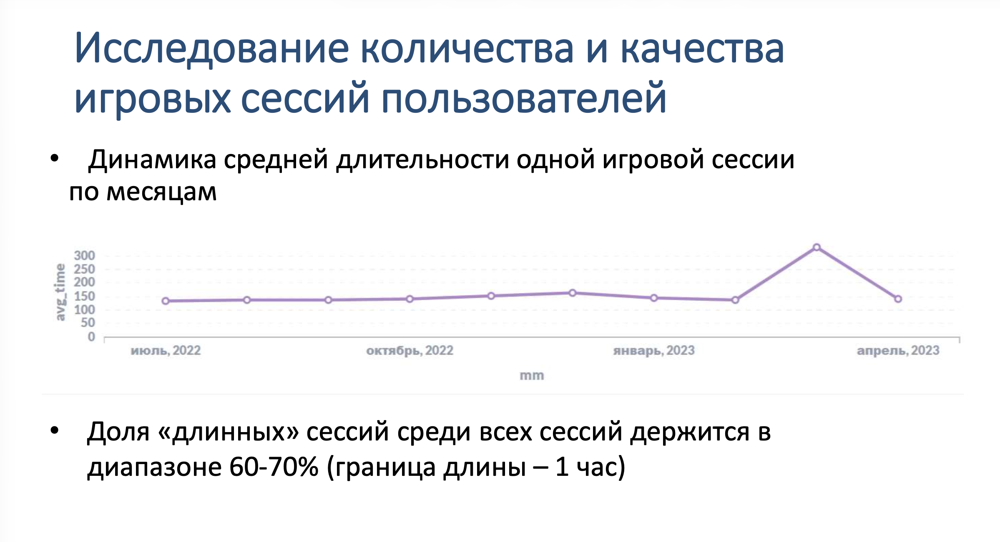
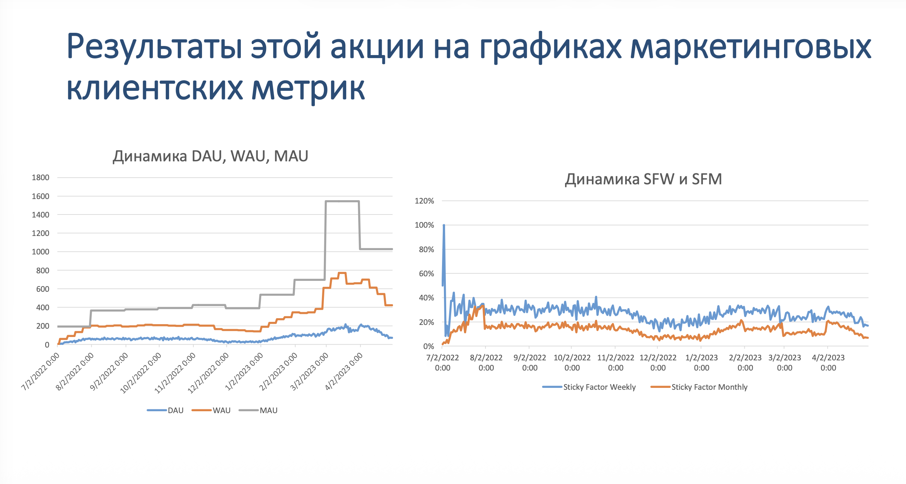
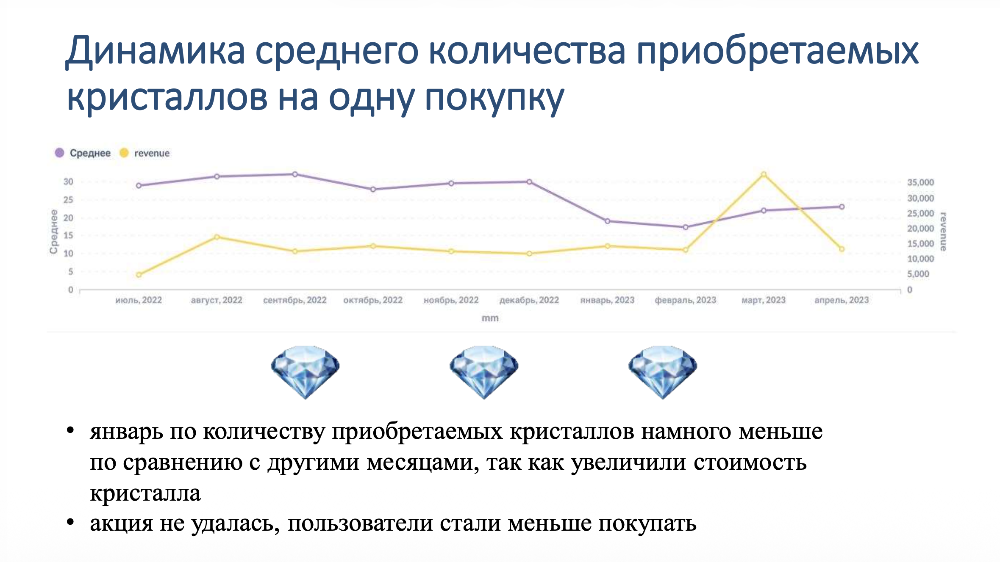

# Итоговый отчет: Анализ Zombie Revolution

В этой папке представлен комплексный анализ мобильной игры Zombie Revolution, оформленный в виде единого фрейма для менеджмента. 

## О проекте
Задача аналитика — не просто посчитать цифры, но и донести их до бизнеса. В данной презентации собран единый сторителлинг, который отвечает на ключевые вопросы руководства: 
насколько здорова игра, какие у неё технические проблемы, как сработали маркетинговые активности и каков потенциал вирального роста.

## 📊 Структура презентации

1. **Общие метрики игры**
   - В базе зафиксировано **3078** пользователей. 
   - Количество игровых сессий — **27 161**, из них «длинных» (дольше 5 минут) — **19 357** (71%).
   - Доля «длинных» сессий (от 1 часа) стабильно держится в диапазоне 60–70%.

2. **Качество данных (Data Quality)**
   - Выявлена проблема: у некоторых сессий отсутствует время окончания (`end_session`).
   - Число проблемных записей — **3262** (12% от всех данных).
   - **98% проблемных записей** прилетает с устройств **iOS** и только 2% с Android. Рекомендовано передать это в отдел разработки.

3. **Маркетинговая активность (Метрики вовлечения)**
   - В марте 2023 года прошла акция. Количество заходов выросло на **+41%** (с 3383 до 5779).
   - На графиках четко виден рост метрик **DAU, WAU, MAU** в марте. Sticky Factor (SFW и SFM) также показал позитивную динамику.

4. **Финансовые показатели**
   - В марте 2023 года зафиксирован пик покупок. Выделяются 3 категории-лидера по выручке (Currency, Materials, Ammo).
   - В январе было принято решение увеличить стоимость кристаллов, что привело к падению количества приобретаемых кристаллов на одну покупку. **Вывод:** повышение цен негативно сказалось на конверсии в покупку.

5. **Вирусность и лояльность (K-factor)**
   - Рассчитан K-factor = **0.92** (почти 1 новый игрок на каждого текущего).
   - Определены портреты «лояльных пользователей» (тратят > 1000 руб., приглашают > 3 друзей).

6. **Новый канал привлечения (Ноябрь-Декабрь 2022)**
   - В рамках проверки гипотезы о привлечении студентов было выявлено изменение среднего времени в игре (когорты 11-12.2022 против остальных).

## Файлы в папке
- `Zombie_Revolution_Analytics_Report.pdf` — итоговая презентация.

## 🖼 Превью презентации

**Общие метрики и динамика игровых сессий:**
На графике виден резкий рост средней длительности сессии в марте 2023 (в период акции).

**Динамика метрик вовлечения (DAU, WAU, MAU, Sticky Factor):**

**Финансовые показатели и влияние изменения цен на кристаллы:**

