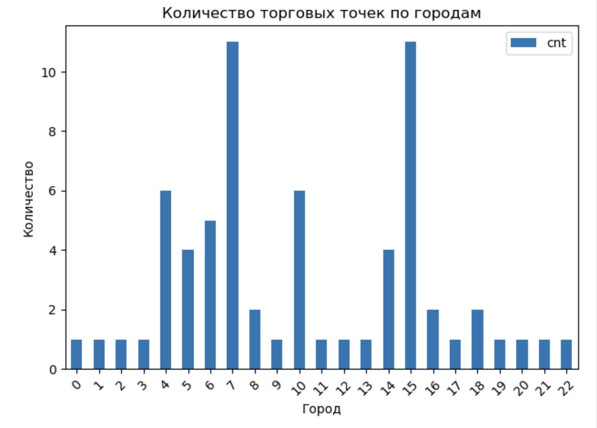
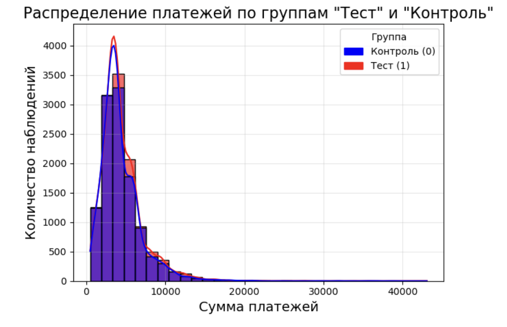

# Дипломный проект: A/B-тестирование маркетинговой механики (SkyLenta)

## О проекте
В рамках дипломной работы я выступала в роли аналитика данных крупного федерального ритейлера SkyLenta. Руководству компании требовалось принять обоснованное решение о смене маркетинговой механики: заменить баннеры в приложении на пуш-уведомления. 

Для проверки гипотезы об эффективности нового канала (с точки зрения конверсии в покупку и среднего чека) был спроектирован и проведен A/B-тест, длившийся 3 месяца.

## Инструменты и стек
- **Python** (`pandas`, `numpy`, `scipy`, `matplotlib`) — очистка данных, расчет статистик, автоматизация и циклы.
- **Статистика** — проверка гипотез (t-критерий Стьюдента, критерий Манна-Уитни).
- **Excel** (`xlsxwriter`) — создание финального калькулятора для бизнеса.

---

## Этапы работы

### 1. Очистка и подготовка данных (Data Preparation)
- Импорт 3 таблиц (заказы, клиенты, регионы), проверка на нуллы.
- Отсечены аномальные платежи (выбросы ниже 0.5% и выше 99.5% квантиля).
- Агрегация платежей по клиентам, объединение таблиц через `LEFT JOIN` (чтобы не потерять клиентов без покупок).
- Создан бинарный флаг факта покупки.

### 2. Автоматизация статистических вычислений
- Написаны собственные функции `test_calc` (для t-теста) и `mann_whitney_func` (для U-теста Манна-Уитни), которые автоматически выводят текст с результатами в зависимости от `p-value`.

### 3. Сегментация и поиск аномалий
- Написаны циклы для очистки данных от нерепрезентативных торговых точек (где в одной из групп не было покупок или наблюдений).
- Проведен общий анализ A/B-теста, а затем сегментированный анализ по городам (Москва, СПб, другие города).

### 4. Создание Excel-калькулятора для бизнеса
- Результаты теста выгружены в многостраничный Excel-файл.
- Торговые точки разделены по лейблам: **Успешные** (положительный исход), **Неуспешные** (отрицательный исход) и **Нет разницы** (нейтральный исход).
- **Калькулятор:** создан инструмент, который прогнозирует прирост/падение выручки на основе заданных параметров. 
  - При заданном количестве клиентов **N = 7630** и MDE = 10064 руб., суммарный положительный эффект составил **+2 028 088,87 руб.**
  - Суммарный отрицательный эффект (падение) составил **-195 432,87 руб.**
  - Для нейтральных точек калькулятор рассчитал, что необходимо **42 наблюдения** для достижения значимости при текущем стандартном отклонении.

---

## Визуализация данных

**Распределение торговых точек по городам**
Больше всего торговых точек находится в Москве и Санкт-Петербурге (по 11 штук). Это самые крупные сегменты для анализа.

**Распределение платежей в контрольной и тестовой группах**
Красным цветом выделена тестовая группа (пуш-уведомления), синим — контрольная (баннеры). Видно, что пик платежей в тестовой группе смещен вправо (в сторону больших сумм).

---

## 📈 Ключевые выводы для бизнеса
По результатам A/B-теста новая механика пуш-уведомлений показала **статистически значимый рост среднего чека** в большинстве крупных городов (Москва, СПб, Казань, Самара). Однако в некоторых регионах (Волгоград, Краснодар) зафиксировано падение.

С учетом разработанного калькулятора, **баланс прироста и падения выручки составляет +1 832 656 рублей**. Это означает, что внедрение новой механики пуш-уведомлений **экономически обосновано и принесет компании чистую дополнительную прибыль**. 

**Рекомендация:** внедрить пуш-уведомления для всех торговых точек, но провести дополнительный аудит процессов в регионах с отрицательным исходом (Волгоград, Краснодар).

---

## Описание файлов проекта

1. 📓 **[diploma_ab_test.ipynb](diploma_ab_test.ipynb)** — Jupyter Notebook с полным кодом исследования (очистка, функции, статистика).
2. 📊 **[ab_test_calculator.xlsx](ab_test_calculator.xlsx)** — Итоговый Excel-калькулятор для менеджмента (4 листа с расчетами и прогнозами).
3. 💾 **[diploma_dataset.xlsx](diploma_dataset.xlsx)** — Единый исходный датасет эксперимента (листы: Данные, Clients, Region_dict).
4. 🖼 **[cities_distribution.png](cities_distribution.png)** — График распределения торговых точек.
5. 📈 **[payments_distribution.png](payments_distribution.png)** — Гистограмма распределения платежей.
